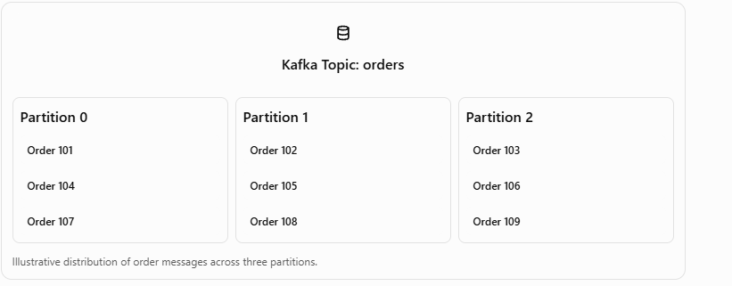
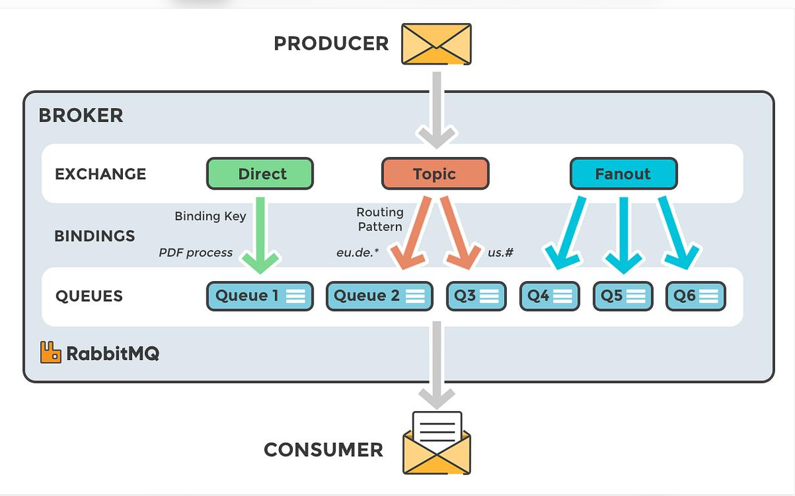

#


### Apache Kafka:
- Distributed event Streaming Platform
- used to publish,store and consume.
- It is mainly used in the distributed platform and Microservice.


### producer and consumer:


- Publishes the message to Kafka topics.
- Consumer consume the message from topics.

### Kafka topic:
- Topic is named stream of events in Kafka.


eg:
user-created
order-created
payment-completed

### Kafka Partition:
- Kafka topics can be divided into smaller parts called partition



#### offset:
- Every message inside the partition is called offset

0- order 101
1 - Order 104
2 - Order 107


### Diff between Kafka and RabbitMQ:

Kafka | RabbitMQ
----- | ------
Event recording system | task Delivery System
Stored events | Stored Queued Messages
Multiple service can read the same event | Queue Distribute to Workers
Supports Replay | Acknowledge messages are removed.


Kafka -> Record Events -> Mutiple service can read them -> Read them again if needed


eg:
```bash
{
    event:"ORDER_CREATED",
    orderId:101,
    amount:5000
}
```
- Payment process 101
- Inventory process 101
- Notification process 101

RabbitMQ -> Given a task -> Worker does a task -> task completed.



Eg:

```bash
{
    task:"send_email",
    orderId:101
}
```

- workers receives the task, send the email and acknowledge the message.


### Aysnchronous Messaging:

- Asynchronous messaging allow services to communicate.
- without waiting for the receiving service to finish processing.


### idempotent Operation:
- Process operation in Multiple times results same output.

- to prevent this to use the transactionId and database unique constraints.


