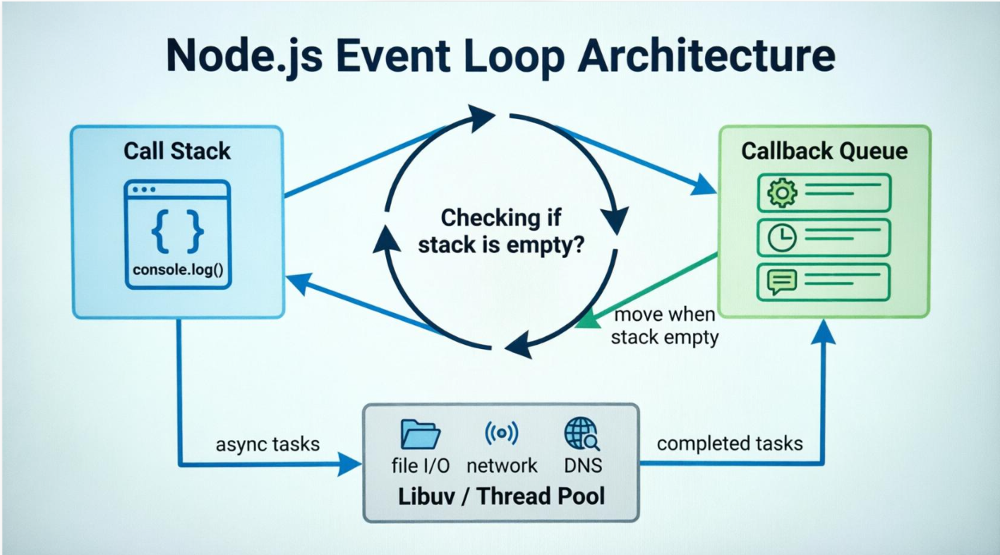

# 


### Nodejs is single threaded.
- Nodejs is single threaded.
- Handled additional threads using the `libuv`


### Event Loop:
- Is a mechanism which allow asynchronous operations without blocking the Main thread


```javascript
console.log("Start");

setTimeout(()=>{
  console.log("timer");
},1000);


console.log("End");

```
output:

Start
End
timer


### How Event Loop works:
 - Coordinate Asynchronous callbacks and Process different Phases(6 phase).

**Nodejs Works:**

- Call stack : Executes the Synchronous code.
- Nodejs/ libuv : Handle Asyncronous code.
- Callback Queues: Hold callbacks waiting for execution.
- Event Loop: Coordinates callback execution





#### 6 Phases:

1. Timers
2. Pending Callbacks.
3. Idle and Prepare.
4. Poll.
5. Check.
6. Close Callbacks.


### Libuv:
- C library used in Nodejs.
- Provider Asynchronous I/O Operations,Event loop functionality.
- Helps nodejs to handles the Asynchronous Operations efficiently.


### Diff between Blocking and Non Blocking I/O:

Blocking I/O Operations - Blocks I/O waits until the Operation finishes
Non Blocking - Allows the program to continue execution while processing


```javascript

const fs=require('fs');

// Blocking
const file=fs.readFileSync("test.txt",'utf8');


// Non Blocking
const data= fs.readFile("test.txt",'utf8',(err,data)=>{
    console.log(data);
});

```

### setTimeout() and setImmediate():


Settimeout():
- Schedules a callbacks after minimum delay.
- It is in Timer Phase.


setImmediate():
- Schedules a callbacks in the `check phase` of the event loop


```javascript


console.log("Start");

setTimeout(()=>{
    console.log("timeout");
},0);


setImmediate(()=>{
  console.log("Immediate");
});

console.log("End");

```

**output:**
Start
End
Immediate
timeout


Possible output 1:
Timeout
Immediate


Possible output 2:
Immediate
Timeout


Why?

When both are scheduled from the main module, their execution order is not guaranteed. It depends on timing and how the Event Loop progresses.


### process.nextTick():

- process.nextTick() shedules a callback.
- to run after the javascript Operation completes.
- before the Event loop execution.


```javascript

console.log("Start");

setTimeout(()=>{
  console.log("Timeout");
},0)

process.nextTick(()=>{
  console.log("Tick");
});


console.log("end");

```

Output:
Start
end
Tick
Timeout


### process.nextTick() and promise.then():

both are microtask . But Maintain separate Queues.

- Process.nextTick exutes the before the Promises.


```javascript

Promise.resolve().then(()=>{
    console.log("Promise");
});


process.nextTick(()=>{
  console.log("nextTick");
});

```


Output:
nextTick
Promise

### Concurrency in Nodejs

- Handles Muliple operations at a time during overlapping all the time
- Nodejs achieves concurrency using its event loop and Asynchronous I/O Operations


```javascript
console.log("Request A has started");


setTimeout(()=>{
    console.log("Request A has ended");
},3000)

console.log("Request B has started");

setTimeout(()=>{
    console.log("Request B has ended");
},1000);

console.log("Request C has started");

setTimeout(()=>{
    console.log("Request A has ended");
},2000)


console.log('End');

```

output:
Request A has started
Request B has started
Request C has started
End
Request B has ended
Request A has ended
Request A has ended

### Concurrency and Parralism:


Concurrency | Parralism
------ | -----
Multiple task make progress over overlapping periods | Multiple task exexutes simultaneously
Can happen in single threAad | need multi threads
Event loop | Worker threads


### How Nodejs Handle Mutiple Requests Simultaneous:

- Receives http requests.
- Executes javascript in the normal thread.
- I/O handles in Asynchronous
- While one request is waits for I\O operation, others processed.
- it is concurrency Operations.


### CPU intensive Operations runs on the Main Thread.

- It blocks the Event Loop.


Solution:
1. worker threads.
2. Child Proccess.
3. Background Job Queues.

